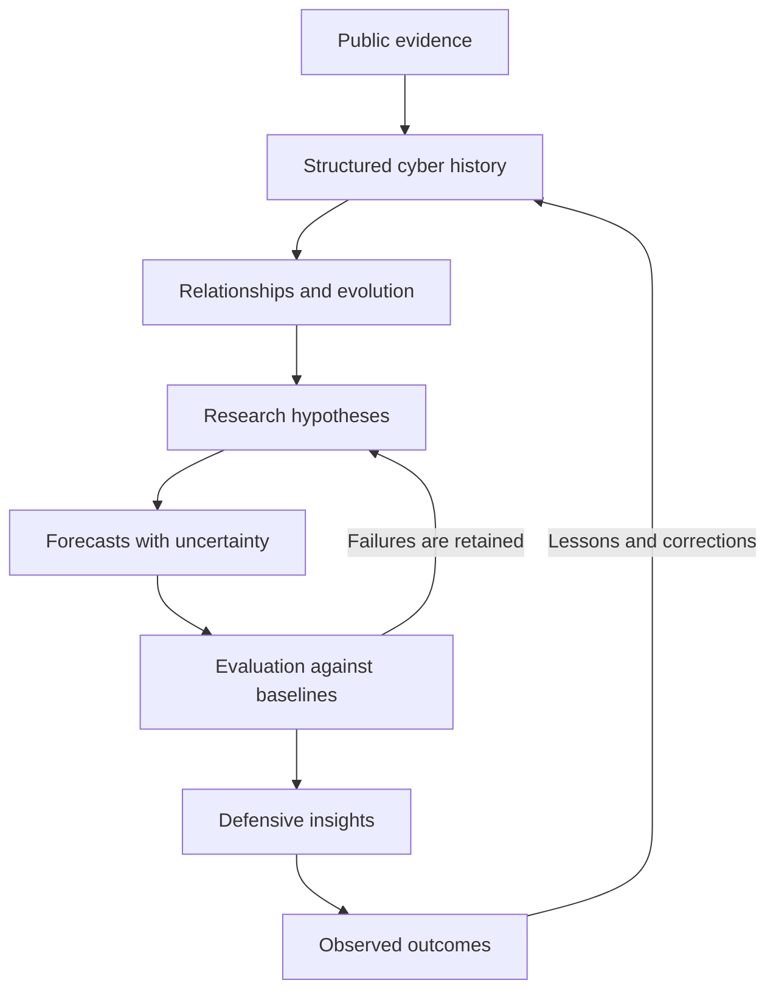

<!--
Cyber Evolution Initiative (CEI)
Evidence-first research into how cyberspace changes over time.
-->

# 🌐 Cyber Evolution Initiative

### Understand the past. Model change. Prepare for what comes next.

**An evidence-first research initiative exploring whether the history of cyberspace can help defenders anticipate emerging threats.**

 

[**Explore the research**](./Research/README.md) · [**Read the methodology**](./Docs/Research_Methodology.md) · [**View the roadmap**](./ROADMAP.md) · [**Contribute**](./Community/CONTRIBUTING.md)

---

## The question

> **Can we understand how cyberspace evolves well enough to help defenders prepare for emerging threats before they become widespread?**

Cybersecurity produces an enormous trail of evidence: incidents, vulnerabilities, malware, techniques, defensive changes, technical reports, and lessons learned. These records are often studied individually.

**CEI aims to connect that history into a research foundation** for studying how cyber capabilities emerge, change, spread, and disappear—and for testing whether those patterns can support useful, measurable defensive forecasts.

This is a research question, not a promised result. Forecasts may fail, signals may be weak, and simpler methods may outperform AI. The evidence decides.

## How CEI works

<table>
<tr>
<td width="50%" valign="top">

### 01 · Collect evidence
Document public incidents, vulnerabilities, techniques, defensive responses, and reliable sources.

### 02 · Structure knowledge
Normalize dates and entities, preserve provenance, and connect related events without erasing uncertainty.

### 03 · Study evolution
Investigate how techniques emerge, combine, spread, mutate, and decline—and how defenses influence those changes.

</td>
<td width="50%" valign="top">

### 04 · Form forecasts
Generate specific, time-bounded hypotheses with explicit probabilities, assumptions, indicators, and falsifiers.

### 05 · Evaluate honestly
Compare forecasts with simple baselines using only information available at the forecast cutoff.

### 06 · Improve defense
Test whether validated findings can inform practical defensive priorities, under human review and within authorized environments.

</td>
</tr>
</table>

**The feedback loop is the point.** A forecast should remain inspectable after it is made. Successes and failures both become part of the evidence.

## Research status

CEI is currently focused on establishing the research archive, documentation, and methodology. The complete forecasting pipeline is a long-term objective, not a claim that a production forecasting system already exists.

| Workstream | Current state |
|---|---|
| Public incident research | In progress |
| Research methodology and architecture | Documented; expected to evolve |
| Structured, queryable knowledge base | Planned / early design |
| Forecasting models and automated evaluation | Planned |
| Controlled validation and defensive decision support | Planned |

See the [full roadmap](./ROADMAP.md) for phases and exit conditions.

## Explore the project

| Area | What you'll find |
|---|---|
| [Research archive](./Research/README.md) | Incident reports, timelines, vulnerability research, and related evidence |
| [AI architecture](./Docs/AI_Architecture.md) | Proposed components and the research feedback loop |
| [Cyber evolution](./Docs/Cyber_Evolution.md) | Concepts for studying changes across the cyber ecosystem |
| [Research methodology](./Docs/Research_Methodology.md) | Hypotheses, evidence standards, baselines, and temporal discipline |
| [Forecast evaluation](./Docs/Forecast_Evaluation.md) | Calibration, lead time, false positives, and outcome assessment |
| [Ethics and safety](./Docs/Ethics%20and%20Safety.md) | Authorization, dual-use review, and human oversight |
| [Research questions](./Questions.md) | Open questions across connected disciplines |
| [Community and education](./Community/README.md) | Ways to participate and curated learning resources |
| [Mission](./Mission.md) · [Philosophy](./Philosophy.md) | The long-term motivation behind CEI |

## Research principles

- **Evidence before assumptions.** Trace important claims to sources; label interpretation and uncertainty.
- **Time matters.** Preserve when information became available to prevent hindsight and temporal leakage.
- **Baselines before complexity.** AI must be compared with meaningful simple methods.
- **Forecasts must be falsifiable.** Define the target, horizon, indicators, and what would count against the claim.
- **Keep the failures.** Do not silently rewrite forecasts or discard inconvenient outcomes.
- **Human accountability.** AI outputs support review; they do not replace responsible human decisions.
- **Authorized research only.** Active testing belongs in explicitly authorized, controlled environments.

Read the full [research methodology](./Docs/Research_Methodology.md) and [ethics and safety policy](./Docs/Ethics%20and%20Safety.md).

## Contribute to CEI

A useful contribution doesn't have to be code. You can:

- Add a well-sourced public incident or timeline.
- Find primary sources and correct unsupported claims.
- Connect an incident to relevant vulnerabilities, techniques, or defensive changes.
- Propose a falsifiable research question or baseline.
- Improve documentation, data quality, tooling, or evaluation.
- Challenge assumptions respectfully—with evidence.

Start with the [contribution guide](./Community/CONTRIBUTING.md) and the [research archive](./Research/README.md).

## What CEI is—and isn't

CEI is an attempt to test whether historical cyber evidence can support better understanding and preparation. It is **not** a claim that the future can be predicted perfectly, that AI is automatically superior to analysts, or that a proposed architecture has already been validated.

The project should change when the evidence demands it. If a hypothesis fails, the record should say so. If a simple model wins, that result matters.

---

**Understand the evolution. Test the forecast. Measure the value.**

CEI is an evolving research initiative. Documentation describes current intent and planned work; implementation status is stated explicitly wherever possible.

